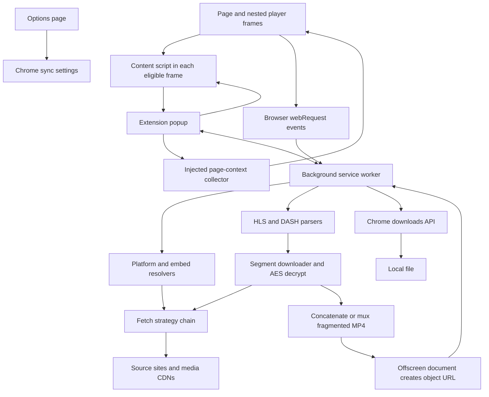
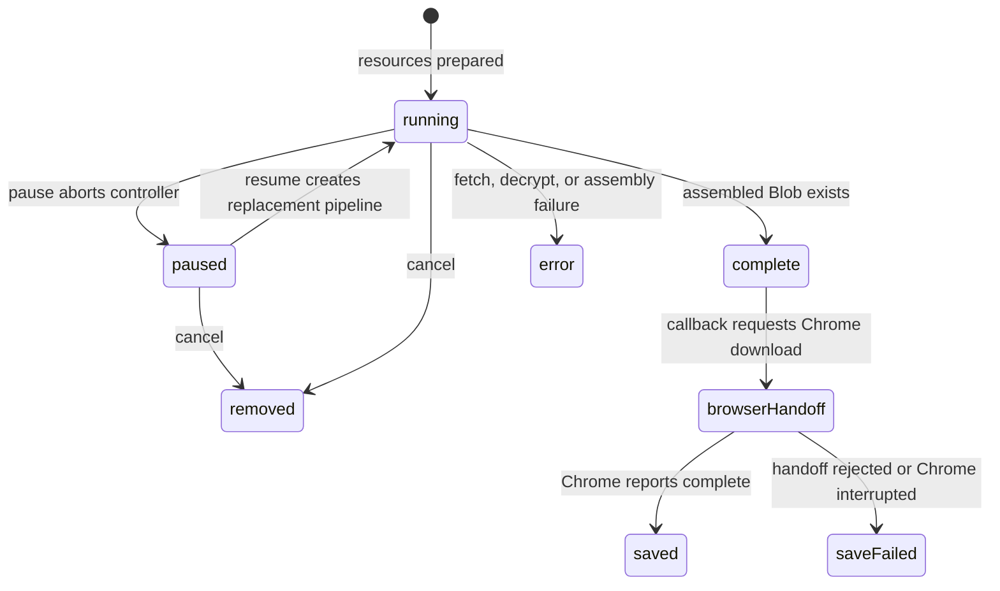

# Video Downloader — Product and Technical Design

- **Owner:** Rich Crane
- **Status:** Comprehensive draft. The owner approved the foundation and authorized completion of all remaining draft sections. Open product decisions and unverified behavior remain explicitly identified below.
- **Date:** 2026-11-02
- **Scope:** The complete Video Downloader product, treated as one feature: save a video the user can access as a local file.
- **Implementation baseline:** Source commit `d888734b587c04857b4532666f0a0b543ea5af4f`; `manifest.json` declares version 2.4.3. This identifies source configuration, not a verified published release.

## Overview

Video Downloader is a Chrome Manifest V3 extension that detects videos on the page the user is viewing and saves a selected video for offline use. Its users include professionals keeping webinars and training, students keeping lectures, and researchers or journalists retaining recordings they are authorized to access. The primary journey is: open the page, open the extension, identify the desired video, choose an available quality, and download a playable file.

Video download is the product's single feature, but it spans several browser processes and media formats. Some sites expose a direct file. Others expose HLS playlists or DASH manifests that describe many segments. Embedded players may run in another origin, require the user's signed-in session, and keep their playback URLs inside a platform API or network requests. The design must connect discovery, source resolution, authentication, parsing, fetching, decryption when supported, assembly, and file delivery without presenting these internal steps as separate products.

The extension runs locally using plain JavaScript modules, browser APIs, and bundled utilities. It has no application backend, developer account system, telemetry, advertising, or runtime package dependencies. Site and CDN requests remain necessary to retrieve player information, manifests, segments, keys, and selected direct files. The user can need an account with the source site; the extension does not supply access rights or bypass a site's authentication.

The existing implementation separates responsibilities among a content script running in frames, a background service worker, popup and options pages, media utilities, and an offscreen document. The offscreen document supplies browser capabilities unavailable in the worker, including creation of object URLs for assembled downloads. The technical plan will trace these boundaries and the actual messages and data exchanged between them.

Supported download paths include direct video, HLS, DASH, supported AES-128 HLS encryption, and resolution of recognized embedded players. Additional controls include quality selection, stream progress, pause/resume/cancel within an active job, audio-only output for supported DASH audio tracks, copying source links, and downloading detected slide decks. These controls support the central video-saving journey rather than expanding the product into editing, transcoding, or a media library.

The product also includes the installation package, first-use terms, settings, marketing site, machine-readable product information, test suite, and release process. A comprehensive design must explain how those surfaces represent the same capabilities and limits. `DESIGN.md` remains the visual design system; this document describes the whole product and its technical operation rather than replacing that file.

### Document coverage

The completed document will cover:

1. User journeys from installation and terms acceptance to selecting, downloading, and opening a file, including unsupported and failed cases.
2. Browser components, execution environments, permissions, ownership of state, extension messages, and trust boundaries.
3. DOM and network discovery, dynamic pages, nested frames, deduplication, media titles, and slide discovery.
4. Embed classification, platform APIs, frame-attributed network evidence, HTML fallback, and source selection.
5. Fetch strategies, session cookies and tokens, signed URLs, HTTP ranges, and restrictions on credential propagation.
6. HLS and DASH parsing, quality selection, initialization segments, encryption, DRM refusal, audio selection, and container assembly.
7. Job lifecycle, concurrency, retry and partial-output policy, progress, pause/resume/cancel, worker suspension, navigation, and cleanup.
8. Popup, options, terms, and website behavior, including keyboard access, focus, reduced motion, compatibility copy, and the visual-system contract.
9. Storage, privacy, security, resource limits, browser compatibility, and operational failure modes.
10. Testing and acceptance, packaging, automatic review and CI, release promotion, publication, rollback, and remaining evidence gaps.
11. Architectural alternatives, their trade-offs, and the distinction between recorded decisions and alternatives not yet evaluated with the owner.
12. A file-by-file implementation and verification plan for any agreed gaps; documenting existing behavior does not itself authorize new product work.

## The Problem

A visible play button does not imply an accessible download file. Playback can depend on a playlist, separate audio and video tracks, short-lived signed URLs, a cross-origin iframe, or cookies available only in the player's browsing context. Browser media may appear as a `blob:` URL that points to a local playback buffer rather than the original downloadable resource. Saving that URL or the manifest text does not produce the requested video.

Users also need enough information to choose the right recording when a page contains several players, thumbnails, advertisements, or unrelated background requests. Associating a captured manifest with the wrong iframe can save the wrong video even when the network request itself is valid. A shared hostname is insufficient evidence that a stream belongs to the selected player; frame ownership matters.

Downloads can fail after substantial work because a segment is temporarily missing, a token expires, a server rejects a request made from the wrong context, or the browser suspends the worker. Failures need explicit states and actionable messages. A download that skips media must disclose the loss; a stopped job must not be presented as complete. A saved file must have an extension and container consistent with its actual bytes.

Privacy and compatibility claims can also mislead. Broad host permissions and cookie access need concrete justification. Saying that processing is local must not imply there are no network requests or that browser-synchronized settings never leave the device. Saying the product works on most video sites must not imply support for YouTube, DRM-protected services, arbitrary live recording, or every codec and player variant.

Finally, the current repository contains implementation, architecture notes, product copy, visual rules, and tests with different levels of detail and historical claims. The design document must reconcile them against code. A passing test using browser API doubles is useful evidence, but it does not establish real Chrome lifecycle behavior, actual authenticated cross-origin access, decoder compatibility, or successful disk delivery.

## Goals

The following are product acceptance goals. They are not assertions that every path has already passed live-browser verification.

1. **Save the selected video.** Discovery and resolution must retain enough source and frame identity to avoid substituting another player's stream. A page with sibling and nested embeds must return the selected player's source or an explicit failure.
2. **Produce a useful local file.** Direct downloads retain their media contents. Stream downloads assemble the selected segments in order and use an appropriate filename, MIME type, and extension. Supported DASH paths combine audio and video without re-encoding; supported audio-only paths produce audio output without downloading the video track.
3. **Cover the implemented input formats precisely.** Document direct files, HLS master/media playlists, transport-stream and fragmented-MP4 HLS, DASH representations, initialization data, ranges, and supported AES-128 handling. State unsupported format combinations rather than treating format names as blanket compatibility promises.
4. **Resolve embeds through explicit fallbacks.** Explain when a supported platform API is used, when captured manifests are eligible for the selected frame, and when embed HTML is parsed. Failures must not silently broaden attribution to unrelated requests.
5. **Use existing access without expanding it.** Explain how the user's page context, cookies, and URL tokens enable authorized fetches, where credentials are held, and which destinations may receive them. DRM-protected media must be refused rather than decrypted through a bypass.
6. **Expose a truthful job lifecycle.** Distinguish preparation, fetching, paused, cancelled, failed, assembling, handed to Chrome, and saved states where the implementation supports them. Document the boundary between resuming an in-memory job and recovering work after a worker, browser, or extension restart.
7. **Bound failure recovery.** Record the current downloader's six concurrent segment requests, five-retry limit, capped backoff, required-segment treatment, and skip threshold of at most 10%. Specify output warnings and failure conditions, and verify the exact counting behavior in the technical plan.
8. **Keep controls usable.** Users must be able to select quality, follow progress, pause/resume/cancel eligible jobs, copy links, and understand failures. Keyboard focus, labels, reduced-motion preferences, and non-color status information form part of acceptance.
9. **Make privacy inspectable.** Identify every storage location and outbound request class. Separate downloaded media, temporary media buffers, authentication data, local terms acceptance, and settings stored through `chrome.storage.sync`. No telemetry or developer-owned processing endpoint may be introduced.
10. **Explain resource and lifecycle limits.** Account for buffering, simultaneous jobs, browser API availability, object URL lifetime, closed popups, tab/frame changes, and service-worker suspension. Unmeasured memory or size limits must remain unmeasured rather than becoming invented guarantees.
11. **Keep all product surfaces consistent.** Installation instructions, README, architecture notes, popup, website, structured data, and `llms.txt` must agree on supported behavior, limits, output formats, and release version. Marketing-site accessibility does not stand in for extension accessibility.
12. **Provide reproducible delivery and acceptance.** Describe dependency-free local loading, deterministic regression fixtures, source syntax checks, real-browser acceptance, versioned packaging, branch promotion, automatic review, release assets, and rollback. Distinguish source merged, checks passed, package published, website deployed, and user journey accepted.

## Non-Goals

- Circumventing DRM, paywalls, authentication, account permissions, or copyright restrictions.
- Supporting YouTube, Firefox, or Safari as part of the current product contract.
- Providing a hosted download service, cloud media processing, developer accounts, analytics, advertising, or a remote media library.
- Editing video, generating captions, translating content, or transcoding arbitrary formats and codecs. Repackaging existing media into a container is distinct from re-encoding it.
- Guaranteeing compatibility with every website, player configuration, encrypted stream, codec, or browser-managed page.
- Treating a live HLS playlist snapshot as a promise of continuous live recording or including separate HLS audio-rendition merging as an established capability.
- Promising durable download recovery across worker/browser restarts without implementation and real-browser evidence for that behavior.
- Treating a format preference or filename extension as a media conversion operation.
- Redesigning the visual identity or changing repository permissions, branch policy, or review settings as a side effect of documenting them.
- Adding dependencies, permissions, production code, or new capabilities through this drafting workflow.

## Open Questions and Evidence to Resolve

These items will be investigated while drafting the technical plan. They are not approved requirements for new implementation.

- Which preferences have observable effects on every applicable download path, and which are stored but unused or limited to some paths?
- What happens to each job type when the popup closes, the source frame navigates, the service worker is suspended, or the extension reloads? Separate intended behavior from actual code and browser evidence.
- Which DASH codecs, containers, and presentation shapes are accepted by the bundled muxer, and how are unsupported inputs rejected?
- Where do credentials and signed URLs cross execution-context or origin boundaries, and which safeguards are enforced at each call site?
- Which error and partial-output states are visible to the user, including skipped segments and failures during final file delivery?
- Which limits on memory, media duration, file size, and concurrent jobs are enforced, measured, or unknown?
- Which real-Chrome, authenticated-site, playback, and accessibility acceptance results exist for the current candidate? Historical documentation and test doubles alone do not resolve this.
- Which architectural alternatives were explicitly evaluated and rejected by the owner? Record unknown history rather than inventing rejected options.

## Source Basis for This Section

- [Project instructions](AGENTS.md) and [manifest](manifest.json): product constraints, execution model, declared permissions, source version, and release flow.
- [README](README.md) and [architecture notes](docs/ARCHITECTURE.md): existing feature descriptions and known limitations; descriptive claims require reconciliation with implementation.
- [Product context](PRODUCT.md) and [visual design system](DESIGN.md): audiences, positioning, supported scope, and visual contracts.
- [Service worker](src/background/service-worker.js), [segment downloader](src/utils/segment-downloader.js), and [offscreen document](src/offscreen/offscreen.js): component boundaries, in-memory jobs, limits, and object URL handling.
- [Options](src/options/options.js) and [terms acceptance](src/popup/terms.js): synchronized settings and local first-use state.
- [Test coverage notes](tests/README.md): regression scope, API doubles, and historical browser-verification gaps.

## Reading the Technical Design

**Implemented** means the behavior is present in the inspected source. It does not mean every site or browser path has passed acceptance. **Acceptance requirement** means the outcome required to meet the goals above. **Gap** means source behavior is missing, narrower than the goal, or needs specific verification. **Decision needed** means multiple defensible approaches exist; this draft does not silently choose a new architecture.

No production implementation is changed by this document. The implementation plan later in the document is conditional on resolving its named decisions. No fresh-context independent design review or new browser acceptance run was performed while writing it.

## Critical User Journeys

### 1. Install and accept terms

- **Given:** The user has a compatible Chromium browser and an unpacked release package containing the manifest, source, and icons.
- **When:** They load the folder through Developer mode and open the extension popup.
- **Then:** The popup shows the manifest version and redirects to terms until `termsAccepted` is true. Accept stores that flag in `chrome.storage.local` and returns to the popup; decline closes the window. No Video Downloader account is created.
- **Acceptance:** A new profile, a returning profile, and decline all behave as described. Restricted pages produce an access/empty state rather than a promise that detection succeeded. Acceptance is currently a boolean, not a versioned record of terms acceptance.

### 2. Discover and save a direct video

- **Given:** An accessible page exposes a video URL through its DOM, metadata, player configuration, or network requests.
- **When:** The user opens or rescans the popup and chooses Download on the intended item.
- **Then:** Results are merged by URL, a readable filename is chosen, and the worker asks Chrome to download the direct URL. The popup tracks the resulting Chrome download ID while that popup instance remains open.
- **Acceptance:** Duplicate discovery does not create duplicate cards; progress handles known and unknown total size; an interrupted download exposes a retry state. A downloaded extension is not evidence of transcoding.

### 3. Resolve the intended embedded player

- **Given:** A page contains multiple sibling or nested players, possibly hosted on the same domain, and the user can watch the chosen player.
- **When:** They select Resolve Stream for that embed.
- **Then:** The worker tries a matching platform resolver, eligible captured manifests, and finally embed HTML. Captured manifests must belong to a frame whose document URL matches the embed or one of its descendants. Exact origin affects ordering only after frame ownership is established.
- **Acceptance:** Player B never resolves to player A merely because their origins match. If frame enumeration fails, the generic network association is unavailable; API and HTML fallbacks may still work. No result, request failure, and DRM are distinguishable outcomes where supported by the relevant UI path.

### 4. Download HLS

- **Given:** An HLS master or media playlist is accessible and does not declare unsupported protection.
- **When:** The user selects an available quality or accepts the only available variant, then starts the download.
- **Then:** The worker resolves a media playlist, inserts required initialization segments, fetches segments in playlist order, decrypts supported AES-128 data, and assembles a Blob. Transport-stream HLS produces `.ts`; HLS containing initialization maps produces `.mp4`.
- **Acceptance:** Saving playlist text is a failure. Byte-range requests and signed-URL fallback preserve the requested bytes. A snapshot of live HLS contains only the current parsed window, not future segments. Separate HLS audio-rendition merging is outside the implemented contract.

### 5. Download DASH video and audio, or audio alone

- **Given:** An accessible MPD has usable, unprotected representations.
- **When:** The user selects a video representation or an Audio only entry.
- **Then:** Video selection combines the chosen video, or the highest-bandwidth video fallback, with the highest-bandwidth audio representation when present. Explicit audio selection omits video. Separate fragmented-MP4 tracks are repackaged without re-encoding; audio-only output uses `.m4a`.
- **Acceptance:** Test output by parsing and decoding a real clip, checking both tracks and their timing. A successful Blob construction alone does not prove playback compatibility. Multiple periods, non-fMP4 representations, alternative audio languages, and unusual codec combinations need explicit acceptance rather than implied support.

### 6. Pause, resume, and cancel

- **Given:** A stream job exists in the current worker instance and has not finished assembling.
- **When:** The user pauses and resumes it through the popup.
- **Then:** The downloader preserves completed buffers, starts a replacement pipeline on resume, and avoids counting a completed segment twice. Cancellation removes the job and its buffer/controller registry entries and resets that popup's controls.
- **Acceptance:** Already saved bytes are not fetched again during ordinary in-memory resume. Cancellation and pause must be tested during a request, retry delay, and immediately before assembly. Underlying fetch cancellation is incomplete as described below; this journey does not promise immediate network cessation or restart recovery.

### 7. Handle inaccessible or damaged media

- **Given:** A key, segment, player API, or final save fails, or the media declares DRM.
- **When:** The user attempts resolution or download.
- **Then:** Unsupported protection stops the supported stream path. Fetch failures consume the defined retry/fallback process. Eligible unavailable media can be omitted under the current skip policy; the completion text reports a skipped-segment count.
- **Acceptance:** Required initialization data is not silently omitted. Expired authorization does not trigger credential collection beyond the existing session. A partial output is labeled partial, a failed save is not labeled saved, and source URLs/tokens are not copied into public diagnostics. These acceptance conditions exceed some current UI behavior and require the gap decisions below.

### 8. Reopen the popup or restart the worker

- **Given:** The user closes the popup, or Chrome stops and recreates the worker.
- **When:** They reopen the popup.
- **Then:** Discovery runs again, including Resource Timing manifest recovery from available frames. This can restore evidence of a source URL, not the segment buffers of a lost job.
- **Acceptance:** Reopening must not imply that a previous stream job was durably resumed. Current popup state is not rehydrated from the worker's job APIs. Browser-native direct downloads and extension-managed stream assembly have different lifetimes.

### 9. Use supporting controls and settings

- **Given:** Detected videos, eligible slide links, and an available options page.
- **When:** The user copies a source link, starts a media download, downloads a slide deck, or saves settings.
- **Then:** Copy places a direct/manifest URL on the clipboard. Starting a video download also invokes slide downloads for decks discovered on the page; users can download a deck individually. Settings are stored in browser sync storage.
- **Acceptance:** A copied link can contain a signed token and may expire. Slides retain their document extension. Current automatic slide downloads must be documented rather than represented as a separate opt-in step. Stored default quality and notification settings do not currently control behavior.

## Technical Plan — Existing Architecture

### Components and execution contexts



The diagram describes existing responsibilities. It does not introduce a backend, persistent download service, or additional extension permission.

| Component | Source | Responsibility and lifetime |
| --- | --- | --- |
| Extension definition | `manifest.json` | MV3 worker, all-frame detector registration, popup/options entry points, permissions, icons, version. |
| Frame detector | `src/content/detector.js` | Reads one document, maintains URL-indexed discovery maps, reacts to selected DOM mutations, responds to discovery and content-fetch messages. Lifetime is that frame's document. |
| Page context | `src/utils/page-context.js` | Injected collector for titles, slides, and Resource Timing manifests; helpers choose names and merge results. |
| Coordinator | `src/background/service-worker.js` | Network registries, embed resolution, format expansion, stream orchestration, direct downloads, offscreen handoff, and progress messages. Lifetime is one worker instance. |
| Popup | `src/popup/popup.html`, `popup.css`, `popup.js` | Active-tab discovery, result presentation, quality selection, copy and download actions, transient progress controls. Lifetime is one popup document. |
| Terms | `src/popup/terms.html`, `terms.js` | First-use explanation and local acceptance flag. |
| Options | `src/options/options.html`, `options.css`, `options.js` | Stores preferences; actual consumption is narrower than the settings offered. |
| Fetch layer | `src/utils/fetch-strategy.js` | Context-dependent resource retrieval and per-host/per-operation successful-strategy cache. |
| Embed resolution | `src/utils/iframe-resolver.js`, `platform-resolvers.js` | Classification, URL-token/header construction, HTML discovery, platform-specific source lookup. |
| Manifest parsing | `src/utils/hls-parser.js`, `dash-parser.js`, `xml-lite.js` | Converts manifests into selectable representations and ordered resource specifications. XML parsing remains loadable in a worker without `DOMParser`. |
| Media processing | `src/utils/segment-downloader.js`, `aes-decrypt.js`, `mp4-mux.js` | Parallel fetching, retries, optional decrypt, ordered buffers, and local output assembly. |
| File handoff | `src/offscreen/offscreen.html`, `offscreen.js` | Creates and revokes object URLs; it does not own the download pipeline or persist jobs. |
| Formatting | `src/utils/formats.js` | MIME/extension mapping, size and quality labels, URL-derived filenames. |

### Permissions and their purposes

The manifest declares `activeTab`, `cookies`, `downloads`, `offscreen`, `scripting`, `storage`, `webRequest`, and `webNavigation`. It also declares `<all_urls>` and explicit ON24/Akamai host patterns already covered by that broad grant.

- `downloads` hands direct and assembled files to Chrome and observes download state.
- `offscreen` supplies the document context needed for object URLs.
- `scripting` injects the page-context collector and MAIN-world fetch helper.
- `webNavigation` enumerates frame IDs and parent relationships and resets network discovery on top-level navigation.
- `webRequest` observes media requests from eligible sites and frames. These listeners are observational; this design does not use request-blocking interception.
- `cookies` supports existing-session fetch attempts. Cookie handling is a sensitive boundary, not a general account-management feature.
- `storage` retains settings and terms acceptance. `activeTab` is declared for active-page interaction; the broad host grant means the overall permission surface is not limited to a click-time grant.

These are explanations of present configuration, not proof that every permission is minimal. Any permission reduction or addition needs a separate behavioral assessment. Restricted browser pages, unavailable frames, and missing host access remain possible failures. Documentation mentions Chrome/Edge 114+, but the manifest does not declare a minimum Chrome version; the actual supported-version floor needs runtime acceptance.

### Discovery and identity

The detector runs at `document_idle` in eligible frames, with a per-document guard against duplicate injection. It scans video/source elements, object/embed elements, metadata and structured data, selected inline player configurations, Mux elements, iframe patterns, YouTube thumbnails/embeds, and consent-placeholder structures. Inline script scanning skips scripts larger than 2,000,000 characters. Detecting a YouTube embed is not implementing YouTube downloading.

URLs are resolved against the frame document. `blob:` sources are excluded from direct discovery because they identify a local buffer rather than an independent downloadable source. A mutation observer rescans for added media/player elements and selected class changes used by consent integrations. It does not promise observation of every possible SPA state change; an explicit rescan calls the detector again. Discovery maps live in the frame and are not a persistent index.

The worker separately records requests using URL paths and response MIME types. Path matching avoids interpreting an analytics query parameter containing a manifest URL as a manifest request. Per-tab registries track visible video candidates and manifests, including requesting frame IDs. Individual media segments, keys, and known child-playlist names are filtered from the displayed video list. Top-level navigation or closing a tab clears its worker discovery registries; it does not constitute a full stream-job cleanup policy.

The popup queries every enumerated frame separately and tolerates a failed frame response. A broadcast fallback exists when frame enumeration is unavailable, but that does not guarantee collection of every frame's response. DOM and worker results are merged by exact URL; iframes are deduplicated independently. Streams are sorted ahead of direct items for title assignment. Exact-URL deduplication does not establish that two differently signed URLs identify different recordings, nor that one URL reused by several frames uniquely identifies one player.

The injected context collector chooses a visible player-modal title when possible, then player/page title evidence, and collects eligible slide links. Filenames remove prohibited characters and cap the chosen base name at 100 characters. Chrome remains responsible for its final download-name validation and collision behavior. Resource Timing recovery re-registers previously observed manifest URLs with frame IDs. URL-indexed recovery can collapse repeated uses of the same manifest URL; it is not a full playback-session identifier.

### Embed resolution

`resolveIframe(url, tabId)` builds authentication context, finds frames whose document URL exactly equals the embed URL, and includes their descendants. It then tries:

1. **Platform resolver.** Mux and Cloudflare often derive a manifest URL from the player URL. JW Player, Wistia, Vidyard, Vimeo, and Panopto use player metadata or HTML to locate a manifest. Panopto favors a podcast stream when available. These are platform-specific conventions that can change; a recognized domain is not a permanent compatibility guarantee.
2. **Frame-attributed network manifests.** Only requesting frames in the selected embed subtree are eligible. Same-origin eligible results are ordered ahead of eligible CDN results. A matching origin or prefix alone cannot establish ownership. Child-playlist filtering can also exclude a usable candidate, so failure still needs a fallback.
3. **Embed HTML.** The worker fetches the embed URL and extracts candidate manifest URLs and protection indicators. This fallback uses `resolveManifestsFromEmbed`'s worker fetch rather than the full context strategy chain.

The result contains candidate manifests, optional stream/protection information, and constructed authentication headers. The popup selects the first candidate and expands it; it does not expose a general multi-candidate resolver chooser. It stores auth context transiently with the item. Exact iframe URL matching can fail after redirects or player navigation; that is a documented limit rather than permission to substitute another frame's manifest.

### Fetch strategies and authentication

Resource fetches receive a context consisting of tab ID, optional frame ID, optional auth headers, optional abort signal, and optional Range header.

| Strategy | Actual mechanism | Important boundary |
| --- | --- | --- |
| `page-main-world` | Injects an async fetch into the page or selected frame with `credentials: include`; returns bytes encoded as base64. | Sends Range when requested, but does not forward the worker's custom Authorization/Cookie headers or abort signal into that injected function. Subject to the chosen page context and its network behavior. |
| `content-script` | Messages an eligible detector to fetch with `credentials: include`; returns base64, with a legacy numeric-array decode path in the caller. | Can target a known frame. Without a frame ID, a message response is not a guarantee of selecting the original requesting player. Custom auth headers and cancellation signal are not passed through this message. |
| `sw-cookies` | Copies supplied headers, optionally gathers cookies, and fetches from the worker. | Manually constructed Cookie headers and cookie access must be verified in the target browser; code that constructs a header is not proof Chrome transmits it as intended. |
| `direct-fetch` | Fetches from the worker using supplied headers and `credentials: include`. | Keeps raw binary data in the worker and avoids the page-message base64 transfer. Actual cross-origin permission and credential behavior needs browser acceptance. |

For manifests and keys, initial order is MAIN world, content script, worker cookies, direct worker fetch. For segments it is direct worker fetch, MAIN world, content script, worker cookies. The winning strategy is cached by hostname and operation type, not tab, account, frame, scheme, or port. The cached strategy is tried first; failure clears it and retries the full eligible chain. This is a performance heuristic, not a security policy.

Each strategy attempt has a 30-second promise timeout. The wrapper rejects the wait without aborting the underlying fetch. A single logical segment attempt can invoke several strategies and a signed-URL fallback; the segment retry count is not a total HTTP-request count.

Cookie lookup tries an origin, hostname, and, if still empty, a parent formed from the last two hostname labels. That last fallback is not a public-suffix-aware registrable-domain calculation. Token extraction recognizes selected URL parameters; a token containing a dot can become a Bearer Authorization value. Constructed auth headers can be reused for manifest, segment, key, or platform URLs. The implementation does not establish a destination allow-list for those headers. This is a security gap to assess before making a claim that tokens are always restricted to their intended origin.

Signed-query fallback is narrower: `withQueryFallback` offers the playlist query only when the resource has no query and has exactly the playlist's origin. On the first successful fallback, the job prefers offered fallback URLs for subsequent resources. This exact-origin rule does not resolve the separate question of auth headers reused across origins.

### HLS parsing and output

The master parser extracts variant URLs, bandwidth, dimensions, and labels, sorted for quality selection. The expansion path returns available variants and best-effort encryption information. If expansion fails it returns an empty result rather than a detailed transport error. At download time a master URL is resolved to its best variant when the popup did not submit a variant URL.

The media parser tracks media sequence, durations, active keys, explicit or implicit byte ranges, initialization maps, live/VOD indicators, and selected ad boundaries. It resolves relative URLs and supplies eligible same-origin signed-query alternatives. Media under recognized Anvato/Uplynk ad markers can be excluded. This is targeted handling, not a universal ad-removal engine.

For AES-128, the downloader requires a 16-byte key, imports it using Web Crypto AES-CBC, and caches it by key URI within the job. Explicit IVs are validated and left-padded to 16 bytes. The sequence-derived IV currently writes the sequence through a 32-bit field in a 16-byte buffer; arbitrary 128-bit sequence support must not be claimed. A reused key URI whose bytes rotate is another case requiring explicit testing.

The worker refuses playlists marked with DRM. Detection covers supported SAMPLE-AES/key-format/URI markers and Adobe Access indicators. This does not promise detection of every protection scheme or analysis of every direct file. Generic AES-128 HLS is distinct from circumventing a DRM license system.

Each new initialization-map object encountered is inserted as a required resource before its media. Media buffers are concatenated in order, omitting skipped resources. An initialization map selects MP4 output; otherwise the output is transport stream. The implementation does not poll future live windows, merge alternate HLS audio groups, normalize discontinuities through a transcoder, or guarantee playback merely because all fetches succeeded.

### DASH parsing and output

The worker-safe XML utility supports the tree operations needed by the MPD parser without browser DOM parsing. The parser resolves BaseURL hierarchies, periods, adaptation sets, representations, MIME/codecs metadata, and ContentProtection. It supports explicit SegmentList URLs and inherited SegmentTemplate attributes, including timeline expansion, start numbers, formatted substitutions, presentation offsets, and negative repeats bounded by available timing information. For some single-resource/range-list cases it falls back to fetching the whole representation resource rather than expressing a general byte-range index reader.

Video and audio results are flattened into bandwidth-sorted lists. The worker chooses one video and one audio representation, or only the explicitly chosen audio. It does not implement period-by-period composition, language selection, subtitle download, live MPD refresh, or a general codec support matrix. ContentProtection on selected representations causes refusal.

Selected tracks become one ordered segment specification list, with each track's initialization resource required. A track-layout array records buffer ranges. For a single track, assembly concatenates initialization and media bytes. For multiple tracks, `muxFragmentedMp4` parses single-track initialization data, combines track metadata, renumbers track IDs, copies fragments, rewrites fragment sequencing and track references, and interleaves by decode time. It drops source `sidx`/`styp` boxes rather than transcoding media.

Malformed or unsupported input can throw during muxing, reported as inability to combine video and audio. The bundled muxer expects the fragmented-MP4 structures it parses; the MPD's codec strings are not a proven preflight validation layer. Decode tests, A/V synchronization, multi-period input, absent initialization data, and unusual fragment layouts remain explicit acceptance cases.

### Segment pipeline, retries, and lifecycle

The downloader owns maps for jobs, AbortControllers, and segment buffer arrays. A job stores ID, state, total/completed/skipped counts, skipped indices, bytes, start time, errors, progress callback, fallback selection, and a restart closure. These are internal live objects, not a stable serializable API record.



Only `running`, `paused`, `complete`, and `error` are actual downloader state strings. `removed` represents deletion from maps. `browserHandoff`, `saved`, and `saveFailed` explain subsequent delivery stages; they are not currently encoded as downloader job states. Pausing or cancelling does not stop a Chrome download that has already been handed off.

Up to six segment workers operate per job, sharing a next-index counter. There is no inspected global cap on simultaneous jobs. Each resource has one initial logical attempt plus five retries. Backoff delays are 1, 2, 4, 8, and 16 seconds; the configured 20-second cap is not reached by that sequence. Completed buffers and previously skipped indices are bypassed on resume.

Required resources and global segment index zero cannot be skipped. The actual skip budget is `max(1, floor(totalSegments × 0.1))`. Thus, a job with fewer than ten resources can skip one eligible resource, exceeding 10%. Initialization resources contribute to the denominator. In a combined DASH job, the first media segment of the second track is not automatically protected merely because it is the first media segment of that track. These details differ from an unqualified “never the first segment, at most 10%” promise.

Pause aborts the pipeline controller; resume retains buffers and starts a new pipeline. However, `createFetcherSet` does not pass that controller's signal to its resource calls, and injected/message fetches do not receive it. The loop and retry sleep can observe cancellation, but in-flight requests can continue. Duplicate-buffer guards reduce double counting; they do not establish that all stale callbacks or overlapping resume requests are harmless.

For Range responses, buffers longer than the requested length are sliced to the requested offsets; shorter/equal buffers are accepted. This is pragmatic handling for servers that ignore Range, not rigorous validation of status, Content-Range, expected lengths, or payload integrity.

On assembly success the job becomes `complete`, progress is sent, and `onComplete(blob)` is called. The downloader does not await the async save callback before marking complete or dropping buffer/controller map entries. The job entry and its restart closure remain in the job map; that closure references buffers and key-cache state, so removing a separate buffer-map entry does not prove those bytes are reclaimable. Error paths also retain job data. Explicit cancel removes the registry references, but unresolved network calls can still finish.

### File delivery and progress

Direct files go to `chrome.downloads.download`. Assembled streams first create/reuse the offscreen document, find its service-worker client, post the Blob through a transferred MessagePort, receive an object URL, and then use the same direct-download helper. Blob data uses the service-worker client/MessageChannel path rather than extension JSON messaging.

The worker tracks Chrome download IDs in `activeDownloads`, relays terminal state changes, and polls byte progress every 500ms. For Blob-backed entries, completion/interruption revokes the object URL; starting a Chrome download can also fail and trigger revocation. The object-URL MessagePort wait has no explicit timeout. Worker loss can discard tracking information needed to revoke an outstanding URL. The offscreen document does not implement persistent ownership records or job recovery.

The popup uses separate maps for direct-download and stream-job progress. A stream's assembly-complete message sets the progress text to Complete, the button to Saving, and removes the stream progress mapping. The subsequent Chrome download ID is not registered into the direct-progress map on that path. Consequently, final save confirmation is not fully connected to stream UI state. Closing or rescanning the popup also discards current element mappings. The worker exposes state-query actions, but the popup does not use them to rehydrate jobs.

### Message contracts

These are internal messages observed in source, not externally exposed APIs. Message errors from the worker listener are returned as `{error: message}`; several expansion functions intentionally reduce errors to empty results.

| Direction / action | Principal request fields | Result or effect |
| --- | --- | --- |
| Popup → frame: `getVideos` | Target frame ID supplied to Chrome messaging | `{videos, iframes}` from that detector. |
| Worker → frame: `fetchResourceContentScript` | `url`, optional `range`; optional target frame | Binary resource represented as base64, or error. |
| Popup → worker: `getNetworkVideos` | `tabId` | `{videos}` from per-tab network registry. |
| Popup → worker: `registerManifests` | `tabId`, manifest URL/frame pairs | Recovered entries recorded; returns current videos. |
| Popup → worker: `resolveIframe` | `url`, `tabId` | Manifest candidates and authentication context, with available resolution metadata/error. |
| Popup → worker: `expandHls` | `url`, `tabId`, optional `authHeaders` | Variants and encryption information. |
| Popup → worker: `expandDash` | Same context | Video/audio representations and available protection metadata. |
| Popup → worker: `download` | `url`, filename/MIME context, `tabId`, optional `keepExtension` | Chrome `downloadId`, or error. |
| Popup → worker: `downloadStream` | `url`, `streamType`, `representationId`, `authHeaders`, `filename`, `tabId`, `jobId` | Long-lived response resolves to `{downloadId, jobId}` after handoff, or error. |
| Popup → worker: `pauseStream`, `resumeStream`, `cancelStream` | `jobId` | `{ok: true}` after invoking job operation; a nonexistent job does not produce a strongly typed failure. |
| Popup → worker: `getDownloadState` | None | Chrome records for tracked direct download IDs. |
| Popup → worker: `getStreamJobs`, `getStreamJobState` | Optional `jobId` for one job | Current internal job objects; not a sanitized durable state format. |
| Popup → worker: `getAuthHeaders` | `url` | Constructed headers. |
| Worker → popup: `downloadProgress` | Chrome download ID, available byte/state/error fields | Updates a matching direct-progress element. |
| Worker → popup: `streamProgress` | Job ID, job fields, calculated speed | Updates a matching stream-progress element. |
| Worker ↔ offscreen client | `createObjectURL` plus Blob and MessagePort | Object URL or error on the port. `revokeObjectURL` is a separate message. |

The worker's handler currently ignores its `sender` argument and trusts supplied tab, URL, and job fields. There is no declared `externally_connectable` interface in the manifest, but extension-internal message access and injected-page boundaries still need validation. Spreading the job into progress messages includes callback/Set fields. Chrome serialization behavior and a deliberate serializable state record must be tested before these shapes are treated as reliable contracts.

### State and persistence

| Data | Location | Lifetime / limitation |
| --- | --- | --- |
| DOM candidates and embeds | Detector Maps | One frame document; rescans update discovery. |
| Network video/manifest evidence | Worker Maps by tab and URL | Cleared on tab removal/top-level navigation, or lost with worker termination. |
| Fetch strategy choices | Fetch module Map by hostname/operation | Worker memory; no per-account/frame partition. |
| Auth headers and URL tokens | Transient objects, popup items, request context | No explicit persistent credential store in inspected code; source URLs can still appear in files, clipboard, errors, or browser-managed records. |
| Segment/key/media buffers | Downloader job objects, closures, Maps | In-memory only, with retention issues noted above. No checkpoint database. |
| Chrome download IDs/object URLs | Worker tracking plus offscreen document | Native download lifetime and document/worker lifetimes differ. |
| Popup result/progress mappings | Popup variables | Lost when popup closes or reloads; not restored by current initialization. |
| Settings | `chrome.storage.sync` | `defaultFormat`, `defaultQuality`, `downloadPath`, `showNotifications`; browser synchronization may transmit these through the user's browser account. |
| Terms acceptance | `chrome.storage.local` | Boolean `termsAccepted`; not a terms-version record. |
| Saved media and slides | Browser-selected download directory | User-owned output; browser retains its own download history according to browser configuration. |

### UI, options, and website contract

The popup presents detected sources, embedded streams, optional quality controls, slide decks, copy actions, and progress. It offers retry controls on relevant errors, but some resolution failures disable the original button until a rescan. Available qualities come from parsed manifests, not a quality-conversion service. HLS with only one variant does not need a multi-choice picker. DASH audio entries select an audio representation ID.

`defaultFormat` currently rewrites a filename extension in the shared download helper. It does not transcode or repackage media. `keepExtension` protects slide/document extensions, while assembled streams pass through the helper without that protection. A user setting can therefore mislabel an assembled file. `downloadPath` prefixes the supplied filename and relies on Chrome's validation; it is not an arbitrary filesystem path writer. `defaultQuality` and `showNotifications` are stored but have no inspected runtime consumers. No notification permission or notification implementation is present.

Slides are a supporting part of the current video action: detected links are deduplicated and downloaded when a video download starts, as well as through individual deck actions. PDF links require presentation-related labeling; office/presentation file extensions can qualify directly. Copying a source URL uses the clipboard and may expose a short-lived signed URL to whichever application receives the paste. Neither feature should be advertised as broad document crawling or permanent share links.

The marketing site is a distinct static surface. It explains download capabilities and install steps, points to release assets, and publishes structured data and `llms.txt`. Its approved visual vocabulary is in `DESIGN.md` and `.impeccable/design.json`: warm dark neutrals, Ember for primary actions/capture indicators, Ember Deep for ambient wash, neutral selection backgrounds, and a restrained status color. The booth is an illustration, not a literal representation of the extension's own palette or controls.

Keyboard and accessibility requirements apply independently to the extension and site: visible focus, accessible button/select names, keyboard-operable terms and controls, status understandable without color, readable error text, and reduced motion. The site's top target has a 90px scroll margin and inherits visible focus. That static-site fix does not prove popup focus restoration, live-region announcements, selector labeling, or screen-reader usability.

The extension privacy contract concerns runtime discovery and media fetching. The marketing site has its own hosting/resource requests; website visits cannot be described as making only selected-video fetches. A static site's resource audit and hosting behavior are separate evidence from extension telemetry absence.

## Non-Functional Requirements and Failure Analysis

### Privacy and trust boundaries

The design keeps media processing local and does not add telemetry. Source pages, player APIs, CDNs, and key endpoints still receive requests. Browser sync can transmit settings, and Chrome controls its own download history. Clicking Copy link deliberately exports a URL to the clipboard. Do not log raw cookies, authorization values, full signed URLs, or private page titles into public issue reports or shared test artifacts.

Boundaries requiring acceptance are: untrusted DOM → detector; frame results → popup; popup messages → privileged worker; manifest-supplied URLs → credentialed fetch; page MAIN-world code → extension binary transport; Blob → offscreen client → Chrome download. Treat source content, URLs, XML, HTML, and API responses as untrusted input even when a user can watch the player.

Current risks include reused auth headers across destinations, broad cookie fallback, ignored message sender metadata, insufficient request/data-size limits, URL-bearing error strings, and internal job objects sent over extension messaging. Listing these risks is not proof of an exploit; they are concrete behaviors that prevent stronger assurances until resolved and tested.

### Resource use and performance

- Segment concurrency is six per job; there is no inspected global admission control. Several jobs can multiply requests and retained buffers.
- Completed bytes remain in memory until assembly, and retained closures can extend lifetime afterward. Blob creation, MP4 box rewriting, and base64 transfers can add copies. The system is not a disk-streaming architecture.
- Base64 transports expand binary data by roughly one third before accounting for string/runtime overhead. MAIN-world/content-script paths can therefore cost substantially more memory than a worker fetch.
- Each strategy timeout is 30 seconds; combined retries, strategies, and fallback URLs can make a failed segment take much longer. Timeout rejection alone does not reclaim the underlying request.
- Size, duration, total jobs, total media bytes, MPD/XML expansion, and key-cache growth have no documented enforced end-to-end budgets in this draft. Do not publish invented maximum-file guarantees or throughput targets.
- Progress speed is cumulative bytes divided by wall time since job start, including pauses. Remaining-time estimates are approximate; skipped resources and unknown total sizes complicate progress percentages.

Acceptance should record actual browser version, media size/duration, peak extension memory, completion time, request count, and output validity. Those measurements are required evidence, not numerical performance promises created here.

### Failure behavior matrix

| Trigger | Current behavior / risk | Acceptance requirement |
| --- | --- | --- |
| Restricted page or unreachable detector | Empty/error result, partial frame collection | Explain access limits; do not imply successful complete scanning. |
| Frame removed or redirected | Attribution can become unavailable; fallbacks may fail | Never resolve a sibling player's stream as compensation. |
| Platform API changes | Resolver returns no usable result or caller receives a failure | Continue only applicable fallbacks; show failure honestly. |
| Expired token/session | Fetch strategies retry and may exhaust | No unauthorized access escalation; redact diagnostics. |
| Unsupported protection | Supported parser marks DRM and stream download refuses | No license bypass or successful-download claim. |
| Required resource missing | Job errors after retries | Do not save a media file missing required initialization. |
| Other resource missing | Skip allowed by current formula | Disclose partial output; resolve policy and small-job exception. |
| Corrupt or wrong response bytes | Some failures surface only during decrypt/mux/playback | Validate representative outputs, not HTTP success alone. |
| Pause/cancel during fetch | Pipeline observes controller; fetch may continue | Bound stale work and forbid misleading state transitions. |
| Mux unsupported structure | Assembly throws and job errors | Preserve a useful error without claiming a playable file. |
| Offscreen client or port failure | Creation can error; port response wait can remain unresolved | Bound the wait, release resources, and expose final-save failure. |
| Chrome download interrupted | Worker tracks terminal state while alive | Connect it to the stream's UI and revoke its object URL. |
| Popup closes/rescans | UI mappings lost | Rehydrate or explicitly describe detached-job behavior. |
| Worker/browser/extension restarts | In-memory evidence/jobs lost; discovery can recover some manifests | Do not promise durable resume from URL recovery alone. |
| Large/multiple jobs | Memory/resource exhaustion possible | Establish budgets through measurement and owner choice. |

### Delivery, release, and rollback

There is no extension build step or package manager. Load the repository or unpacked package through Chrome's Load unpacked flow. `scripts/package.sh` reads `manifest.json`, creates `dist/videodownloader-v<version>.zip`, and includes only `manifest.json`, `src/`, and `icons/`, excluding selected macOS metadata. It replaces an existing same-version local ZIP. Website, tests, design documents, and development tooling are outside that runtime archive.

Project flow is feature branch → PR into `develop` → PR from `develop` into protected `main`, with merge commits. A release changes the manifest version, promotes through those branches, and pushes the matching `vX.Y.Z` tag. The release workflow verifies tag/manifest agreement, packages the extension, and attaches the ZIP to a GitHub Release. Install instructions from `.github/release-notes.md` precede generated changelog notes. The workflow itself does not show a dependency on a successful regression job or prove a given tag points at the intended promoted commit; release acceptance must check those separately.

The checked-in regression workflow runs tests and source syntax checks for PRs into `develop`/`main` and pushes to those branches. Automatic cloud Copilot review was configured for `develop` in this conversation; a technical document is not a substitute for inspecting live review policy on a later release. Never request/re-request reviews or make artificial pushes to trigger them.

No current GitHub release, store publication, deployment status, or latest ruleset is asserted here from historical evidence. The website is documented as GitHub Pages, but its current publishing source and deployment status must be inspected when shipping it. Extension release ZIP publication and website deployment are separate outcomes. A submitted store listing is not a published installation channel.

Rollback options are to reinstall a known-good unpacked package, or revert a defective change through the normal PR flow and publish a new version. Do not move an existing tag, rewrite shared history, or call a source revert a completed user rollback. A website rollback must go through its actual deployment source. Download artifacts should be checked by version, runtime contents, checksum, and installation/playback acceptance before recommending them as known-good.

## Alternatives Considered

No predecessor brainstorm records rejected architectures. The choices below distinguish mechanisms already present from alternatives that can be evaluated; none is falsely labeled an owner-approved rejection.

| Area | Existing approach | Alternative, benefit, and failure condition |
| --- | --- | --- |
| Processing location | Local browser download/decrypt/assembly | A hosted service could offload memory and muxing, but would receive media/credentials or require a different auth model and contradict the current no-backend privacy contract. It is outside current scope. |
| Discovery | DOM + structured/player data + network evidence | DOM-only is simpler but misses MSE/opaque players. Network-only sees requests but cannot reliably convey user intent or player ownership without frame/context evidence. |
| Embed resolution | Platform-specific resolution followed by scoped network/HTML evidence | HTML-only avoids endpoint-specific code but fails when manifests arrive through API calls. API-only reduces ambiguous scraping but breaks on unsupported platforms or changed endpoints. |
| Fetching | Multiple execution-context strategies and a cache | Worker-only avoids base64 copies but fails where player context is required. Page-only can inherit session behavior but incurs transport overhead and fails with unsuitable frame context. |
| Media handling | Native Web Crypto and bundled fMP4 utilities | A general media library/WASM transcoder could broaden formats but adds distribution size, dependencies, and processing cost. No such dependency is authorized. |
| Output buffering | Whole-job in-memory buffers | Chunked disk-backed assembly can reduce memory pressure but needs a new storage/output lifecycle and browser compatibility design; it cannot be claimed as an implementation detail already solved. |
| Worker lifecycle | Transient jobs with in-memory resume | Offscreen-owned processing or persistent checkpoints could survive different lifecycle events, but neither is implemented by the current object-URL helper. Both need an owner decision. |
| Partial output | Bounded skip with count in completion text | Fail-on-any-missing-segment preserves completeness but loses useful output on a brief failure. User-selected partial output makes consent explicit but adds UI/state complexity. |

### Decisions still required before behavior changes

Draft approval authorizes documentation, not silent selection among these options.

1. **Partial output:** fail on any missing resource; keep automatic bounded partial output with truthful labeling; or require an explicit user choice to accept partial output. Automatic skipping can omit important content; strict failure can discard hours of otherwise useful media; a choice requires recoverable buffers and clear UX. A strict 10% cap and protection of each track's first media resource are separate testable policy details.
2. **Restart recovery:** explicitly support only in-memory jobs; move eligible execution into a longer-lived browser context; or add durable checkpoints. Transient jobs lose work on termination, a context move still needs resource limits, and checkpoints introduce sensitive URL/media storage and expiration behavior.
3. **Format setting:** remove the misleading override; redefine it as a format-compatible output preference; or preserve it with an explicit filename-only label. Re-encoding is outside scope. A name-only setting can still produce files users cannot open as expected.
4. **Unused preferences:** remove default quality/notification controls, or implement their semantics with a defined quality policy and notification behavior. Implementing notifications may require permission changes, which this draft does not authorize.
5. **Resource budgets:** choose global/per-job limits or restrict supported media size after measurements. Aggressive limits block useful long recordings; absent limits risk browser exhaustion; checkpointed/chunked output is a larger design.

For authentication, the acceptance requirement is clear—credentials must not be forwarded indiscriminately—but exact source/CDN authorization relationships need representative platform evidence before choosing a destination policy. A blanket same-origin rule could break legitimate cross-origin delivery; forwarding to every manifest URL is not an acceptable assurance.

## Detailed Implementation and Verification Plan

### Plan boundaries and order

This is a single, conditional backlog, not a claim that the listed changes have been implemented. Preserve the current no-build, no-runtime-dependency model. Resolve the decisions above before changing the affected product behavior. Do not mix a large recovery/storage redesign into a small lifecycle or documentation correction.

Recommended dependency order is: establish serializable state and delivery semantics; define source/credential boundaries; resolve partial-output and settings policies; implement resource cleanup and cancellation; then decide whether durable recovery or a broader media model is a separate project. The order limits ambiguity for subsequent implementation without selecting the unresolved options.

### Unified file-by-file work list

Only the draft file is changed by this task. The following are the exact existing paths to inspect or modify for an approved implementation; conditional changes are labeled. No deletions, new service, or new persistence schema are approved.

| Paths | Proposed work and reason | Dependency / acceptance |
| --- | --- | --- |
| `src/background/service-worker.js` | Define an explicit serializable job-status boundary; validate message action/context; keep job ID tied to Chrome download ID; report handoff, saved, and failed outcomes separately; bound the offscreen response wait; coordinate cleanup without retaining completed media unnecessarily. Review frame/URL context propagation through expansion and variant downloads. | Existing `downloadStream` response remains compatible or callers change together. Test late callbacks, source navigation, final-save rejection, and terminal-state idempotence. |
| `src/utils/segment-downloader.js` | Separate internal closures/buffers from externally reported state; pass cancellation context through fetch callbacks; prevent stale pipelines from updating a newer attempt; finalize retained resources deliberately on success/error/cancel. Implement only the owner-selected skip policy and resource limits. | Preserve successful in-memory resume and byte ordering. Tests cover small jobs, per-track first media, pause/resume overlap, fatal errors, and byte retention. |
| `src/utils/fetch-strategy.js` | Carry job signals into abortable worker requests; define timeout cleanup; isolate or invalidate cache where frame/auth differences matter; validate permitted request schemes and credential destinations. Establish a browser-verified cookie approach rather than relying on constructed headers alone. | Requires source/CDN auth policy evidence. Test actual request destinations/headers, timeout races, range integrity, and context changes. |
| `src/content/detector.js` | If fetch cancellation and request IDs are adopted, support them in the content-fetch protocol. Validate requested schemes and sender/context expectations; preserve page discovery and frame isolation. Assess stale candidate cleanup and source-change observation without broad rescans unrelated to media. | Update worker fetch messages in the same change. Regress sibling/nested players, SPA replacement, consent placeholders, and restricted frames. |
| `src/utils/iframe-resolver.js` | Define validated auth-context output and URL handling; retain platform/HTML fallback semantics and explicit protection results. Avoid broad cookie/token assumptions in generic embed parsing. | Do not remove currently valid session-based access without test fixtures. Keep exact frame ownership independent of origin sorting. |
| `src/utils/platform-resolvers.js` | Maintain explicit platform extraction contracts and no-result/failure behavior; preserve required signed parameters. Add representative metadata fixtures when changing any endpoint convention. | A platform name in a list is not acceptance. Verify each changed resolver with sanitized data and an authorized live case where possible. |
| `src/utils/hls-parser.js` | Preserve key/map/range sequencing and exact-origin query fallback. If stricter unsupported-format or resource-limit checks are approved, expose explicit results rather than silently selecting unusable media. | Test key rotation, IVs, init changes, ignored Range, live snapshots, ad markers, and protection. Separate HLS alternate audio remains a distinct scope decision. |
| `src/utils/aes-decrypt.js` | Validate key/IV behavior and decide a supported sequence-number range; change integer handling only with fixtures proving existing short-IV and standard sequence behavior remain valid. | No custom cryptographic primitive or DRM bypass. Test invalid key size, malformed IV, padding/decrypt failure, and large sequence boundaries. |
| `src/utils/dash-parser.js`, `src/utils/xml-lite.js` | Make unsupported DASH structures explicit before download; preserve XML/MPD parsing and timing behavior. If expansion limits are approved, enforce them without allowing an unbounded timeline or malformed manifest to stall the extension. | Test inherited templates, period boundaries, IDs, protection, absent durations, SegmentList/single-resource cases, malformed XML, and oversized input. |
| `src/utils/mp4-mux.js` | State and validate the accepted fMP4 input shape; detect unsupported tracks before misleading completion. Preserve track-ID/timestamp rewriting and failure diagnostics. | Real playable A/V fixtures are required in addition to box-structure checks. New codec conversion is outside scope. |
| `src/utils/page-context.js`, `src/utils/formats.js` | Preserve title sanitization, document names, and frame-attributed recovery. If changing identity, track a source independently of a popup element so deduplication and resumed UI do not substitute the wrong player. | Test repeated titles/URLs, signed URLs, mixed slides, missing modal labels, unsafe filename characters, and output-extension agreement. |
| `src/offscreen/offscreen.html`, `src/offscreen/offscreen.js` | Keep the Blob/object-URL transport narrow; add request validation, explicit failure reporting, and ownership/cleanup behavior needed by the coordinator. | The helper remains an object-URL service unless an independently approved lifecycle decision moves work into it. Test port loss and URL revocation after interruption/restart. |
| `src/popup/popup.html`, `src/popup/popup.css`, `src/popup/popup.js` | Connect stream job IDs to Chrome save outcomes; rehydrate a serializable status model if chosen; keep partial output distinct; preserve keyboard focus as controls change; give status/error updates accessible semantics. Reflect the selected settings and slide behavior policy. | Test popup close/reopen/rescan, missing jobs, failure recovery, final save, screen reader labels, reduced motion, and keyboard-only operation. |
| `src/options/options.html`, `src/options/options.css`, `src/options/options.js` | Apply the selected format/quality/notification policy and label sync storage honestly. Validate the download subfolder input within the actual Chrome path rules. | Do not leave controls that claim an effect they do not have. Test storage defaults, invalid input, persistence, and observable download behavior. |
| `src/popup/terms.html`, `src/popup/terms.js` | Update product-limit/privacy text only where an approved behavior change makes existing text inaccurate. A versioned acceptance model is conditional, not assumed. | Verify fresh/returning/declining flows. No legal policy is invented through this technical design. |
| `manifest.json` | Change only for an approved version, verified minimum browser version, or a separately justified permission requirement. | The current draft requires no new permission. Validate all entry points and runtime asset paths. |
| `tests/harness.mjs` | Extend doubles and fixture controls to model state, signals, Chrome serialization constraints, offscreen failures, and download completion rather than making every browser API succeed. | Harness behavior must not hide the production failure being tested. Tests still cannot establish real Chrome behavior. |
| `tests/browser-paths.test.mjs`, `tests/compatibility.test.mjs` | Add meaningful regressions for each implemented fix: skip budgets, per-track required media, terminal save outcomes, serialization, auth routing, cancellation races, unsupported containers, and settings effects. | Run against the actual source/package under test; assert output bytes and lifecycle events, not implementation details alone. |
| `tests/README.md` | Record current commands, fixture limits, real-browser evidence, and remaining gaps with dates and source/package identity. | Historical test counts remain historical; no claim of Chrome acceptance from API doubles. |
| `README.md`, `docs/ARCHITECTURE.md`, `PRODUCT.md` | Reconcile feature descriptions, auth boundaries, recovery, partial-output policy, settings semantics, and format support with the implemented result. | Remove unconditional claims contradicted by source; retain explicit limitations. |
| `docs/index.html`, `docs/llms.txt` | Update user-facing/structured-data claims when approved behavior changes; keep platform resolution order, exclusions, output types, and install/release text aligned. | Check human copy and JSON-LD together. Site deployment and keyboard acceptance are separate from extension acceptance. |
| `DESIGN.md`, `.impeccable/design.json`, `.impeccable/config.json` | Change only if a product/UI change affects documented design tokens or an existing detector exception becomes invalid. Keep intentional short labels and ledger layouts; do not hide new defects behind existing waivers. | No visual redesign is required by this architecture plan. |
| `scripts/package.sh`, `.github/workflows/tests.yml`, `.github/workflows/release.yml`, `.github/release-notes.md` | If release safeguards are approved, ensure the tested source/package identity survives promotion/tagging and that installation instructions describe the actual archive. Keep dependency-free packaging. | Assert tag/version match, runtime contents, test/check outcome, SHA-256, and release artifact installation. No policy bypass or manual review triggering. |
| `design_draft.md` | Maintain this design's baseline, decisions, gap dispositions, and acceptance evidence as the owner approves changes. | Keep it distinct from the visual design system and current release notes. |

Existing `icons/` and `docs/icons/` assets, `docs/images/`, `scripts/generate-icons.js`, `scripts/generate-icons.html`, `scripts/generate-og-card.js`, `docs/sitemap.xml`, and other static marketing assets require no change for the technical corrections above. Their presence in the product does not authorize an asset refresh. If implementation introduces a new source or test file, its exact path and responsibility must be added to this unified list before coding.

### Verification plan

**Source and deterministic integration checks.** Use the checked-in Node 24 workflow command, without installing dependencies:

```sh
node --experimental-vm-modules --test --test-timeout=10000 tests/*.test.mjs
```

Check each changed JavaScript file with `node --input-type=module --check < path/to/file.js`, validate modified JSON, and run `git diff --check`. These commands are specified here; this drafting task did not run a fresh test suite. The repository's tests use production modules with Chrome/DOM/network doubles and native Blob/MessageChannel/WebCrypto. Synthetic transport-stream packets test selection/assembly bytes, not decoder compatibility. No arbitrary coverage percentage substitutes for the acceptance cases below.

**Browser acceptance matrix.** Load the exact candidate package in a clean browser profile, record browser/OS versions and permissions, and retain sanitized output/checksum evidence. Repeat upgrade-sensitive cases in an existing profile. Minimum cases are:

| Area | Required scenarios | Evidence |
| --- | --- | --- |
| Installation | Fresh profile, terms accept/decline, reload/upgrade, restricted page | Correct version/entry points, stored state, visible failures. |
| Detection | Direct DOM, metadata/config, SPA insertion, consent placeholder, nested/cross-origin frames | Expected candidates, deduplication, no query-string analytics false positive. |
| Attribution | Two same-origin siblings, CDN child requests, origin-prefix lookalike, missing/redirected frame | Correct player's source only; fallback behavior on missing evidence. |
| Authentication | Authorized signed-in source, expired token, same-origin query fallback, cross-origin CDN/key | Actual request origin and destination/header behavior, without retaining secrets in reports. |
| HLS | One/multiple variants, TS, fMP4 init changes, explicit/implicit ranges, AES key rotation and IV forms, live snapshot | Expected bytes plus playable output; no playlist-text file; protection refusal. |
| DASH | A/V and audio-only, different timescales, single resource, inherited templates, timeline repeats, multi-period/unsupported input | Track presence, decode/playback, A/V sync, clear rejection where unsupported. |
| Missing data | Required init, first media of each track, small/large skip budgets, wrong key, bad content/range | Selected policy, explicit partial state, no false completeness. |
| Lifecycle | Pause/resume during request/backoff, rapid repeats, cancel, popup reopen/rescan, source navigation | No duplicate counting, stale transition, unintended resource retention, or implied durable recovery. |
| Worker/offscreen | Worker stop/restart, extension reload, missing client, lost port, Blob save rejection, native interruption | Bounded failure, truthful handoff/save state, URL/buffer cleanup. |
| Settings/support | Download path, format choice, default quality/notifications under chosen policy, copy signed link, automatic/individual slides | Observable behavior matches labels and file types. |
| Accessibility | Keyboard through terms, popup, options, site; screen reader status; high zoom; reduced motion | Reachable named controls, visible focus, announced outcomes, readable layouts. |
| Resource use | Long playable clip, large segments, multiple jobs, repeated success/failure/cancel | Peak memory, request count, retained objects, timings, enforced or documented limits. |

Tests using public third-party endpoints are not deterministic regression fixtures. Live platform acceptance must use content the tester is authorized to access and must record the platform/player case without publishing session data. A pass on one Vimeo or ON24 recording does not establish universal platform support.

**Package and publication acceptance.** Run `bash scripts/package.sh`, inspect the ZIP for only required runtime files, compare manifest version and tag, compute SHA-256, and load the unpacked candidate. After release publication verify the attached asset's checksum and installation. For the site verify the deployed source and actual rendered page separately. A PR merge or green CI is not a completed release or a successful user download.

### Completion criteria for an implementation

An implementation is complete only when its chosen behavior is reflected in source, popup/options/site copy, regression cases, real-browser evidence, and the release artifact as applicable. Every gap either has evidence of closure, an owner-approved limit, or an explicitly deferred status. The design document itself is complete as a draft while those implementation decisions remain open; it does not manufacture their approval or claim they were executed.

## Decision and Evidence Record

- **2026-11-02 — Owner scope:** “everything since this app is one feature which is video download. It needs to be comprehensive.” This establishes whole-product scope, not a new feature request.
- **2026-11-02 — Owner foundation approval:** Approved the overview/goals foundation, then authorized “approve everything for draft.” The remaining sections were drafted without repeated section gates.
- **Source baseline:** `d888734b587c04857b4532666f0a0b543ea5af4f`, declared version 2.4.3. Architecture findings above come from local source inspection, not a fresh cloud/release audit.
- **Existing architecture retained:** No backend, new dependency, additional permission, durable checkpoint store, or production change is selected through this drafting task.
- **Unresolved policy:** Partial output, lifecycle/recovery scope, settings semantics, resource budgets, and precise credential-destination rules remain decisions for implementation.
- **Verification status:** Source and documentation inspected for this draft. No new live download, playback, release deployment, independent reviewer run, or complete regression run is claimed.

## Further Source References

- [Content detector](src/content/detector.js), [popup controller](src/popup/popup.js), and [page context](src/utils/page-context.js): collection, UI flows, source naming, and recovery evidence.
- [Fetch strategies](src/utils/fetch-strategy.js), [embed resolver](src/utils/iframe-resolver.js), and [platform resolvers](src/utils/platform-resolvers.js): execution-context and credential behavior.
- [HLS parser](src/utils/hls-parser.js), [DASH parser](src/utils/dash-parser.js), and [XML utility](src/utils/xml-lite.js): manifest structures and limits.
- [Segment downloader](src/utils/segment-downloader.js), [AES utility](src/utils/aes-decrypt.js), and [MP4 muxer](src/utils/mp4-mux.js): retries, buffers, decryption, and output structures.
- [Regression workflow](.github/workflows/tests.yml), [release workflow](.github/workflows/release.yml), [package script](scripts/package.sh), and [release-note template](.github/release-notes.md): checked-in delivery mechanics.
